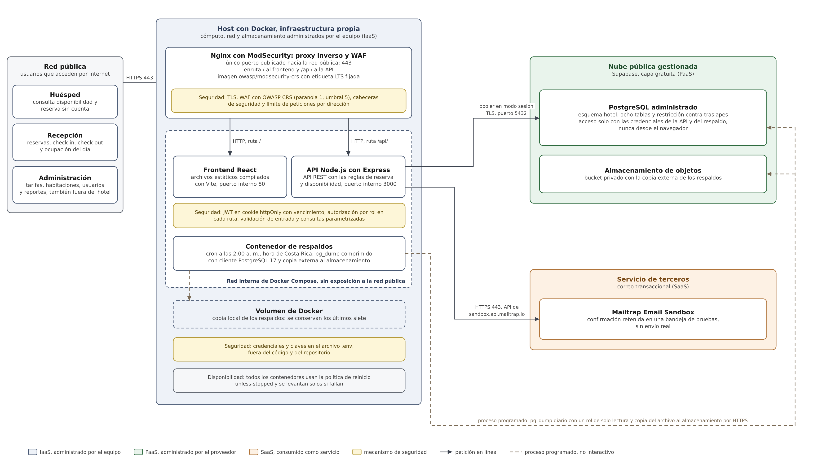
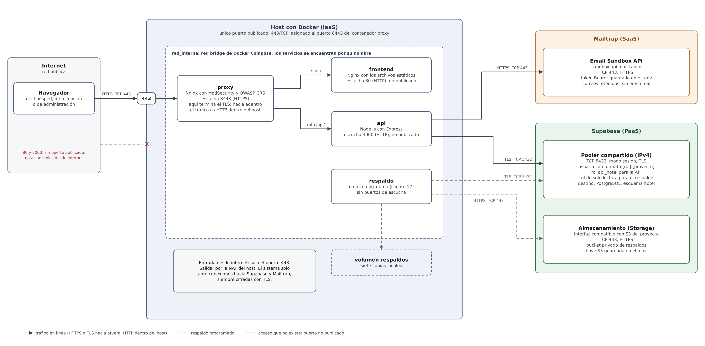

# Hotel Punta Serena: sistema de reservas en la nube

Diseño y simulación de una solución basada en computación en la nube para la gestión de reservas del Hotel Punta Serena.

Proyecto final del curso Arquitectura de la Computación en la Nube, ULACIT.

**Integrantes**

- Roberto Alvarado Hernández
- Emmanuel Alvarez Galeano
- Malory Fallas Cerna
- Carlos Hernández Castillo
- Kevin Villalobos Obando

## Problema

El Hotel Punta Serena es un hotel familiar de catorce habitaciones en Playa Sámara, Guanacaste. Las reservas llegan por WhatsApp y se anotan en una hoja de cálculo en la computadora de recepción. Eso produce cuatro problemas:

1. Sobreventa: dos personas pueden anotar la misma noche.
2. No hay respaldo de la información.
3. No hay control de acceso a los datos personales de los huéspedes.
4. El dueño no puede consultar la ocupación desde fuera del hotel.

La solución debe usar solo herramientas gratuitas y cumplir la Ley 8968 de protección de datos personales.

## Arquitectura

Despliegue híbrido. Los contenedores propios corren en un host con Docker (IaaS conceptual). La base de datos y la copia externa de los respaldos están en Supabase (PaaS). El correo de confirmación se envía con Mailtrap Email Sandbox (SaaS).





| Contenedor | Imagen | Puerto | Función |
|---|---|---|---|
| proxy | owasp/modsecurity-crs:4.25.2-nginx-202610180210-lts | 443 publicado (8443 interno) | Único punto de entrada: TLS, WAF con OWASP CRS, cabeceras de seguridad y límite de peticiones |
| frontend | nginx:1.30-alpine | 80, solo red interna | Archivos estáticos de la interfaz |
| api | node:24.22-alpine3.24 | 3000, solo red interna | API REST con las reglas del negocio |
| respaldo | postgres:17.11-alpine3.24 | ninguno | pg_dump diario con cron a las 2:00 a. m. |

Todos usan la política de reinicio `unless-stopped`. Los diagramas de entidad relación y de casos de uso están en `docs/`, en PNG y en formato editable de diagrams.net (`.drawio`).

## Tecnologías

| Herramienta | Uso |
|---|---|
| Docker y Docker Compose | Contenedores y entorno completo con un solo comando |
| Nginx con ModSecurity y OWASP Core Rule Set | Proxy inverso, WAF y futuro balanceador |
| Node.js 24 con Express 5 | API REST |
| React (siguiente etapa) | Interfaz de reserva y panel interno |
| PostgreSQL 17 en Supabase | Base de datos administrada y almacenamiento de respaldos |
| Mailtrap Email Sandbox | Correos de confirmación retenidos en una bandeja de pruebas |
| Git y GitHub | Historial y documentación |
| diagrams.net | Formato editable de los diagramas |

Bibliotecas de la API: express, pg (consultas parametrizadas), argon2 (Argon2id) y jsonwebtoken.

## Estructura

```
compose.yaml              entorno completo
.env.example              nombres de las variables secretas, sin valores
proxy/                    plantilla de Nginx con el WAF
frontend/                 interfaz (marcador en esta etapa)
api/                      API REST en Node.js
db/schema.sql             esquema, restricciones y roles de mínimo privilegio
db/datos_prueba.sql       datos ficticios
respaldo/                 tarea de respaldo con cron
certs/                    certificado raíz público de Supabase
docs/                     diagramas
```

## Requisitos

- Docker Desktop con Docker Compose.
- Una cuenta gratuita de Supabase.
- Una cuenta gratuita de Mailtrap.
- En Docker Desktop, activar **Settings, General, Start Docker Desktop when you sign in to your computer**. Viene desactivada; sin ella, los contenedores no vuelven solos después de un apagón.

## Preparación (una sola vez)

### 1. Supabase

1. Crear un proyecto en el plan gratuito.
2. En el editor SQL, ejecutar `db/schema.sql` y luego `db/datos_prueba.sql`.
3. Asignar las contraseñas de los roles desde psql (no desde el editor SQL, para que la contraseña no quede escrita en una consulta). En el panel, **Connect, Session pooler** muestra la cadena del usuario `postgres`:

   ```powershell
   docker run --rm -it -v "${PWD}/certs:/c" postgres:17.11-alpine3.24 psql "<cadena del session pooler del usuario postgres>?sslmode=verify-full&sslrootcert=/c/supabase-ca.crt"
   ```

   Dentro de psql:

   ```
   \password api_hotel
   \password respaldo_hotel
   ```

4. Descargar el certificado raíz en **Database Settings, SSL Configuration** y guardarlo como `certs/supabase-ca.crt`.
5. En **Storage**, crear un bucket privado llamado `respaldos`.
6. En **Storage, Configuration, S3**, activar la conexión S3 y crear una llave de acceso. Anotar el endpoint, la región, el identificador y el secreto.

### 2. Mailtrap

En **Sandboxes**, abrir la bandeja. Su número aparece en la dirección del navegador. En **Settings, API Tokens**, crear un token con acceso a esa bandeja.

### 3. Archivo .env

Copiar `.env.example` como `.env` y completar los valores. Las conexiones usan el pooler en modo sesión (puerto 5432) con el usuario `<rol>.<ref del proyecto>`. La llave del JWT se genera así:

```powershell
docker run --rm node:24.22-alpine3.24 node -e "console.log(require('crypto').randomBytes(48).toString('base64url'))"
```

## Ejecución

```powershell
docker compose up -d --build
docker compose ps
```

El sistema queda en `https://localhost`. El navegador advierte que el certificado es autofirmado: en la simulación lo genera el proxy al arrancar; en un despliegue real se usaría Let's Encrypt.

Primer usuario de administración (la contraseña se muestra una sola vez):

```powershell
docker compose run --rm api node src/crear_usuario.js admin "Nombre del administrador" administracion
```

Los demás usuarios se crean con `POST /api/usuarios`.

## API REST

JSON sobre HTTPS. La sesión es un JWT en una cookie `httpOnly`, `Secure` y `SameSite=Strict` que vence en 8 horas. Administración hereda todos los permisos de recepción.

| Método y ruta | Acceso | Requerimiento |
|---|---|---|
| GET /api/salud | Público | Detección de fallas |
| GET /api/disponibilidad?entrada&salida&personas | Público | RF01 |
| POST /api/reservas | Público y recepción | RF02, RF03, RF04 |
| GET /api/reservas?codigo o ?desde&hasta | Recepción | RF05 |
| GET /api/reservas/{codigo} | Recepción | RF05 |
| PATCH /api/reservas/{codigo} | Recepción | RF05 |
| POST /api/reservas/{codigo}/checkin | Recepción | RF06 |
| POST /api/reservas/{codigo}/checkout | Recepción | RF06 |
| POST /api/reservas/{codigo}/correo | Recepción | RF04, reenvío |
| GET /api/ocupacion/hoy | Recepción | RF11 |
| POST, GET y DELETE /api/sesion | Recepción y administración | RF07 |
| GET, POST y PATCH /api/usuarios | Administración | RF07 |
| GET, POST y PATCH /api/tipos, /api/habitaciones y /api/temporadas | Administración | RF09 |
| GET y PUT /api/tarifas | Administración | RF09 |
| GET /api/reportes/ocupacion?desde&hasta | Administración | RF08 |

Códigos de respuesta: 201 creado, 400 datos inválidos, 401 sin sesión, 403 rol sin permiso o petición bloqueada por el WAF, 404 no encontrado, 409 traslape de fechas o versión vieja, 429 demasiadas peticiones, 502 correo no disponible, 503 base no disponible.

Toda modificación envía la `version` que se leyó. Si otra persona guardó antes, la respuesta es 409 y hay que recargar (bloqueo optimista).

## Respaldo y recuperación

- Todos los días a las 2:00 a. m., hora de Costa Rica, `pg_dump` respalda el esquema `hotel` con el rol `respaldo_hotel`, de solo lectura.
- Se conservan las siete copias más recientes en el volumen `respaldos`. La copia más reciente también se sube al bucket privado de Supabase como `hotel_ultimo.sql.gz`.
- Objetivos: RPO de 24 horas y RTO de 30 minutos.

Respaldo manual y registro:

```powershell
docker compose exec respaldo respaldo.sh
docker compose logs respaldo
```

Restauración:

1. Detener la API para que nadie escriba durante la restauración: `docker compose stop api`.
2. Obtener la copia. Una copia local se saca con `docker compose cp respaldo:/respaldos/<archivo>.sql.gz .`. La copia externa se descarga desde el bucket `respaldos` en el panel de Supabase.
3. Restaurar en una sola transacción. Si algo falla, la base queda como estaba:

   ```powershell
   $env:URL_POSTGRES = "<cadena del session pooler del usuario postgres>?sslmode=verify-full&sslrootcert=/c/supabase-ca.crt"
   docker run --rm -i -e URL_POSTGRES -v "${PWD}:/r" -v "${PWD}/certs:/c" postgres:17.11-alpine3.24 sh -c '(echo "DROP SCHEMA hotel CASCADE;"; gunzip -c /r/<archivo>.sql.gz) | psql "$URL_POSTGRES" --single-transaction -v ON_ERROR_STOP=1'
   ```

4. Levantar la API y verificar: `docker compose start api` y `https://localhost/api/salud`.

## Escalabilidad

La API no guarda estado en memoria, así que admite réplicas:

```powershell
docker compose up -d --scale api=3
docker compose restart proxy
```

El proxy reparte las peticiones entre las réplicas. La restricción de exclusión de la base sigue impidiendo los traslapes aunque las atiendan réplicas distintas.

## Seguridad del repositorio

- Ninguna contraseña, clave ni token se sube al repositorio. Los secretos viven en `.env`, que `.gitignore` excluye; `.env.example` lleva solo los nombres.
- Los datos de prueba son ficticios y los correos usan el dominio reservado `example.com`.
- Las pruebas de seguridad se hacen solo sobre este sistema.

## Estado

Los archivos de configuración y el código describen la solución completa. La ejecución integrada, las pruebas y las evidencias se agregarán en la siguiente etapa del proyecto.
